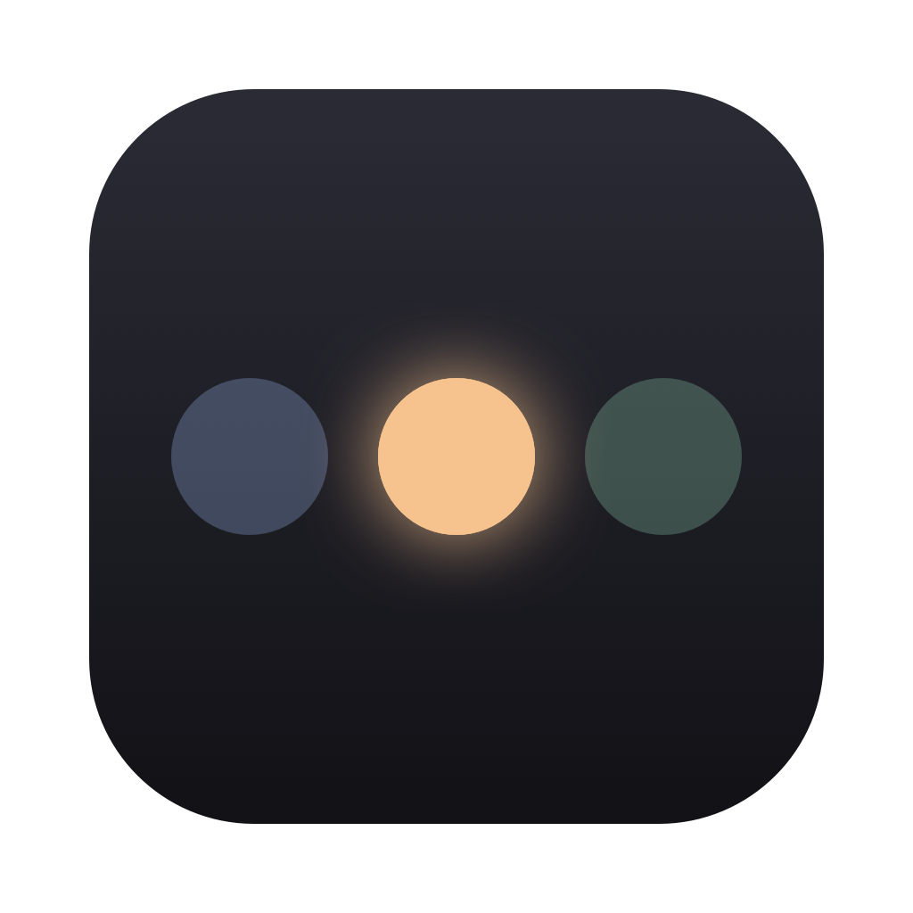
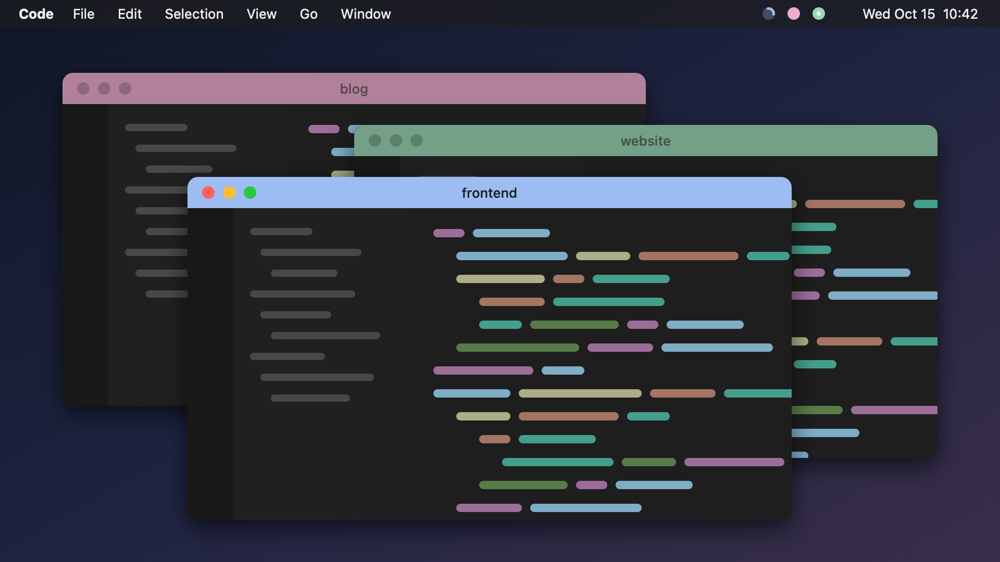
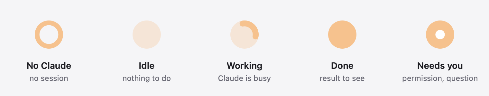

<p align="center"></p>

# Cuelight

A colored light in the macOS menu bar for each VS Code window, showing what Claude Code or Codex is doing in that project. The same color tints the window's title bar, so you can tell at a glance which project needs you.



Each light shows the most urgent agent state in its project:



Click a light to bring its VS Code window to the front and fill the screen. Right-click for the palette and Quit.

## Supported agents

- **Codex:** the VS Code extension and Codex CLI, through the shared lifecycle hooks in `~/.codex/hooks.json`.
- **Claude Code:** the VS Code extension and CLI, through hooks in `~/.claude/settings.json`.

If both agents have sessions in the same project, Cuelight displays the most urgent state: needs you, done, working, then idle.

## Requirements

- macOS 13 or later
- VS Code, with the `code` command available
- Claude Code and/or the Codex extension for VS Code
- Apple's command line tools (`xcode-select --install`)

## Install

```bash
curl -fsSL https://raw.githubusercontent.com/louis-badr/cuelight/main/install.sh | bash
```

This downloads the source, builds `Cuelight.app` on your Mac, puts it in `~/Applications` and starts it. Because it is built locally, macOS doesn't block it even though it isn't notarized.

On first launch, Cuelight sets up the rest by itself:

- adds its hooks to `~/.claude/settings.json` and `~/.codex/hooks.json`, after saving backups next to files that already exist. Your other settings and hooks are kept;
- installs its VS Code extension.

Then:

1. Allow Cuelight in **System Settings → Privacy & Security → Accessibility**. This is only needed to resize the window when you click a light.
2. Quit and reopen VS Code.
3. If you use Codex, review and trust the Cuelight hooks when Codex prompts you. You can also open the hook review with `/hooks`. Codex intentionally does not run newly installed hooks until you approve them.

From then on, opening VS Code starts Cuelight.

If you use Peacock or a similar extension that colors the title bar, disable it. Both would write to the same settings.

## Uninstall

```bash
curl -fsSL https://raw.githubusercontent.com/louis-badr/cuelight/main/install.sh | bash -s -- --uninstall
```

This removes the hooks from `~/.claude/settings.json` and `~/.codex/hooks.json` (after backups), the VS Code extension, the app and `~/.cuelight/`.

## Good to know

- **Title bar colors** are written to each project's `.vscode/settings.json`. Add `.vscode/` to your global gitignore if you don't want them in your repositories.
- **Two projects with the same color:** force one in `~/.cuelight/colors.json`, then reload the VS Code window:
  ```json
  { "my-project": "#F2A6A0" }
  ```

## Build from source

```bash
git clone https://github.com/louis-badr/cuelight.git
cd cuelight
./install.sh        # build and install from this folder
./build.sh          # only build dist/Cuelight.app
```

How it works: [ARCHITECTURE.md](ARCHITECTURE.md).

Agent integration details: [Codex hooks](docs/codex-hooks.md) · [Claude Code hooks](docs/claude-hooks.md).

## License

[MIT](LICENSE)
